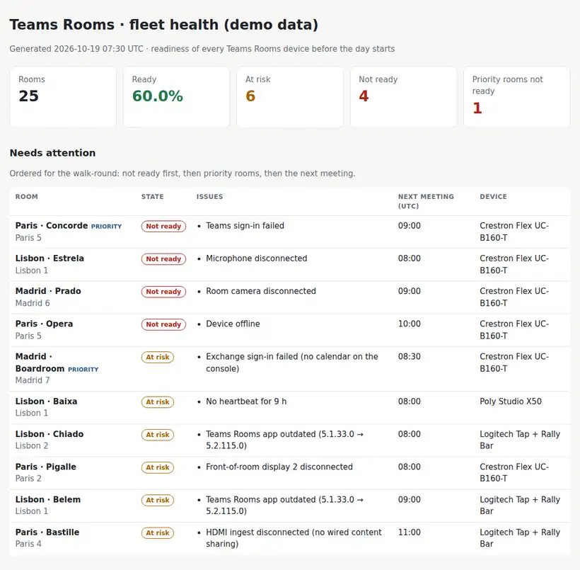

# Teams Rooms Fleet Health

A readiness check for **Microsoft Teams Rooms** across several offices. It reads the device health that Teams already collects (sign-in, camera, microphone, speaker, displays, HDMI ingest, software versions), puts it next to a simple room register and today's bookings, and answers one question before the day starts: **which rooms will fail a meeting, and in what order should someone go and fix them?**

Python 3.10+, standard library only. PowerShell export scripts for Microsoft Graph. Runs with fictional demo data out of the box.



## Why

The Teams admin center already shows the health of every room, one device at a time. What the person on site needs at 08:00 is different:

- a **short list**, not a dashboard,
- **ordered**: the boardroom with a meeting in 30 minutes first, the small room that is free all day last,
- with the **first thing to try** for each problem,
- and a weekly view of what keeps coming back (versions that drifted, rooms nobody registered).

Meeting rooms fail in a few predictable ways: the resource account password expires and Teams signs out, a camera or microphone loses its USB connection, a display is on the wrong input, an update wave stops halfway. This tool turns those signals into a morning round.

## What it does

| | |
|---|---|
| Inputs | Device health from Graph (`/teamwork/devices` + `/health`), a room register (`rooms.csv`: site, floor, capacity, priority) and, optionally, today's bookings (start and end only). |
| Readiness | **Not ready** (offline, Teams sign-in failed, required camera/microphone/speaker/main display down, compute unhealthy), **At risk** (no calendar on the console, stale heartbeat, outdated Teams Rooms app/OS/firmware, second display or HDMI ingest down), **Ready**. |
| Ordering | Not ready first, then priority rooms, then the room with the soonest meeting. |
| Outputs | `report.html` (single file, light and dark mode), `actions.csv` (one row per issue, with serial number for the ticket), `morning_check.md` (the walk-round list), `history.jsonl` (one line per day for the trend). |
| Housekeeping | Firmware drift against the rest of the same model, devices that are not in the room register. |

Runbook for the people using it: [docs/morning-check-runbook.md](docs/morning-check-runbook.md).

## Try it

```bash
git clone https://github.com/inigogonzalezgarcia/17-teams-rooms-fleet-health.git
cd 17-teams-rooms-fleet-health
python -m rooms_health demo
```

Open `output/report.html` and `output/morning_check.md`.

The demo is a made-up company with 25 devices in Madrid, Paris and Lisbon (Crestron Flex, Logitech Rally Bar, Poly Studio X50) on a Monday at 07:30 UTC. Faults are placed on purpose so every rule shows up: a boardroom whose resource account cannot reach Exchange, a priority room blocked by a new Conditional Access policy, a camera and a microphone disconnected, an offline console, a second display off, two consoles on an old Teams Rooms app, firmware drift and an unregistered lab device.

## Use it with your own tenant

1. Install the Microsoft Graph PowerShell SDK (once):
   ```powershell
   Install-Module Microsoft.Graph.Authentication -Scope CurrentUser
   ```
2. Export devices and health. Read-only, scope `TeamworkDevice.Read.All`:
   ```powershell
   .\scripts\Export-TeamsRoomsHealth.ps1 -OutputPath .\teams_rooms_health.json
   ```
3. Write your `rooms.csv` (see `sample_data/rooms.csv`). `priority` = `yes` for boardrooms, executive floors and client rooms.
4. Optional, bookings for today (start and end only, no subjects or attendees). See the script header for how to limit the permission to room mailboxes:
   ```powershell
   .\scripts\Export-RoomBookings.ps1 -RoomsCsv .\rooms.csv -OutputPath .\bookings.csv
   ```
5. Build the outputs:
   ```bash
   python -m rooms_health report teams_rooms_health.json --rooms rooms.csv --bookings bookings.csv --history history.jsonl
   ```
   Options: `--stale-hours 6`, `--window-hours 3`, `--now 2026-10-19T07:30:00Z`, `--out output`, `--title "Madrid · rooms"`.

The exports contain room account names and serial numbers. Keep them, and the reports, inside your organisation. Real exports are excluded from Git by `.gitignore`.

## Tests

```bash
python -m unittest discover tests      # or: pip install -r requirements-dev.txt && python -m pytest
```

14 tests: each readiness rule, the offline case hiding follow-on noise, required vs optional peripherals, the heartbeat threshold, firmware drift, the walk-round ordering, missing sections in the export, the history file and the demo end to end.

**Next steps for a real tenant:** run the two PowerShell scripts with read-only permissions and fill in the room register. The `/teamwork/devices` API is in the Graph **beta** endpoint, so field names can change; the parser treats anything missing as "unknown" rather than failing.

## Roadmap

- Send the morning check to a Teams channel or by email from a scheduled task.
- Add Teams Rooms Pro data (incidents, ticket links) where the licence exists.
- Mark rooms out of service for a planned intervention, so they do not show as failures.
- Combine with Intune compliance (project 02) for the Windows-based consoles.

## Background

Built from my work supporting Microsoft Teams Rooms on Crestron in two offices (with Logitech hardware as the replacement), earlier Poly rooms, and technical support for board and executive committee meetings, where a room that fails in the first five minutes is the thing everybody remembers. Written from scratch with fictional data; no employer code, data or configuration is used.

## Customisation and contact

Want this adapted to your rooms (your sites and priorities, other device brands, a scheduled morning email, integration with your ticketing tool)? Get in touch:

- Website (contact form): [inigogonzalezgarcia.github.io](https://inigogonzalezgarcia.github.io/about.html#contacto)
- LinkedIn: [linkedin.com/in/igonzalez93](https://www.linkedin.com/in/igonzalez93)

## License

MIT
